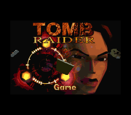
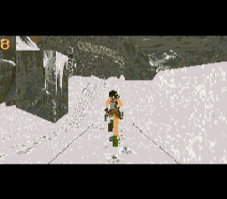
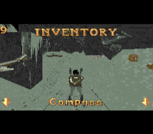
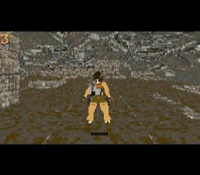

# OpenLara for SNES / Super FX

An experimental Super Nintendo port of OpenLara's fixed-point Tomb Raider
engine. The Super FX renders the 3D world, while C and native 65C816 code
handle gameplay, collision, input and the display pipeline.

The primary target is **FX3**, with **Caves (`LEVEL1`) and City of Vilcabamba
(`LEVEL2`)** on one 4 MiB cartridge. The goal is to match the GBA alpha's
first two levels. The FX3 port runs in **SUPERZSNES (tested with v0.310b)**
and the TypeSNES development emulator. Parity work and physical FX3 hardware
qualification are still in progress.

FX3 uses the [FX3 cartridge specification](https://github.com/LimitedRunGames-Tech/snes-fx3/blob/main/docs/FX3.pdf).
It requires explicit cartridge or emulator support; the FX3 build is not a
standard GSU-2 cartridge image. Separate experimental GSU-2 builds are also
included.

## Screenshots

Captured directly from the two-level FX3 build. The title screen is from
TypeSNES; the gameplay and inventory images are from **SUPERZSNES v0.310b**,
with the in-game FPS overlay visible. Images retain the native 256 × 224
display output; the FX3 game viewport is 216 × 144.

| Title screen | Caves |
| --- | --- |
|  |  |
| **Inventory** | **City of Vilcabamba** |
|  |  |

## What is included

- A Super FX software renderer for textured rooms, portals, static scenery,
  animated models, transparent textures, shadows and sprite effects.
- Lara's movement, jumping, climbing, hanging, swimming and underwater
  interactions, with animation-driven collision and a following camera.
- Creatures, navigation, combat, pistols, magnums, uzis and shotgun support.
- Doors, switches, triggers, pickups, keys, puzzles, pushable blocks and traps.
- An FX3 title screen, inventory ring, health and air bars, options menus,
  passport save/load, battery-backed settings and transitions between levels.
- An SPC700 sound-effect driver and BRR sample conversion.
- A host-side packer that converts original PC level files into cartridge
  data, plus renderer, gameplay, arithmetic and memory-budget checks.

Support is validated around the first two levels. Code and fixtures for
additional creatures and levels are present, but do not establish support
for the full campaign.

## Build the FX3 cartridge

### Requirements

- A C/C++ compiler, GNU Make and Python 3.
- [WLA-DX](https://github.com/vhelin/wla-dx), with `wla-superfx`,
  `wla-spc700` and `wlalink` on `PATH`.
- A built [PVSnesLib](https://github.com/alekmaul/pvsneslib) checkout containing
  `compiler/tcc/816-tcc`, `devkitsnes/tools/816-opt`, and its patched
  `devkitsnes/bin/wla-65816` and `wlalink`.
- Original Tomb Raider PC data: `LEVEL1.PHD` and `LEVEL2.PHD` in the directory
  supplied as `TRDATA`. Add `TITLEH.PCX` to include the title background.

The tested PVSnesLib revision is
`e090f001ccffdc0fb69f479a8c9703e30d07f6b1`. Use its patched 65816 assembler:
the compiler emits substitutions that the standalone WLA-DX build does not
understand. The port uses PVSnesLib's tools rather than its game runtime.

From the OpenLara repository root:

```sh
cd src/platform/snes
make BUILD=build_fx3_ship FX3=1 LEVELS='LEVEL1 LEVEL2' \
  PVSNESLIB=/path/to/pvsneslib \
  TRDATA=/path/to/TOMBENG/data -j8
```

The result is `build_fx3_ship/openlara.sfc`. Keep the generated symbol file
and packed data alongside it when running the validation tools. Original
level files, generated cartridge data and ROMs are not included in this
repository.

Load the ROM in an emulator with FX3 support, or use the corresponding FX3
cartridge hardware. Physical hardware validation remains outstanding. The
title screen's passport opens **Load Game**, where either included level
can be selected; **Current Position** appears when a valid save is present.

### Other configurations

| Configuration | Build flags | Renderer and scope |
| --- | --- | --- |
| FX3 | `FX3=1 LEVELS='LEVEL1 LEVEL2'` | 216 × 144, 8bpp; primary two-level target |
| GSU-2 | `FX3=0 LEVEL=LEVEL1` | 256 × 160, 4bpp; experimental single-level target |
| GSU-2 with Mode 7 display | `FX3=0 MODE7=1 LEVEL=LEVEL1` | 128 × 64, 8bpp; alternative low-resolution display path |

Use a different `BUILD` directory for each configuration. Plain `make`
selects the GSU-2 target. `SHADING=1` enables the optional shading path.
FX3 menus, multi-level loading and other FX3-specific features are not
available in the GSU-2 builds.

## Controls

Default SNES controller mapping:

| Button | Action |
| --- | --- |
| D-pad | Move and turn; navigate menus |
| A | Jump; cancel or back out of a menu selection |
| B | Action: interact, grab, pick up or fire; confirm menu selections |
| X | Roll |
| Y + D-pad | Look around |
| L + D-pad | Walk and sidestep |
| R | Draw or holster weapons |
| Select | Open or close the inventory |

The Controls menu can swap A and B. In the inventory, Left/Right selects an
item, Up/Down changes pages, and B uses or opens the selected item. The
passport provides level selection, saving, loading and return to the title.

## Source layout

The 65816 toolchain compiles C, so this target translates the gameplay in
[`src/fixed`](../../fixed) into C and assembly instead of directly compiling
the shared C++ engine. C implementations also serve as references for
optimized native routines.

| Path | Contents |
| --- | --- |
| `main.asm`, `hdr.asm`, `snes.inc` | Cartridge startup, memory layout, PPU setup, controller input, interrupts, DMA and renderer scheduling |
| `src/` | Gameplay, collision, camera, creatures, navigation, inventory, saves, sound and native 65C816 routines |
| `gsu/` | Super FX transforms, portal traversal, model rendering and rasterizers |
| `src/spc.asm` | SPC700 sound-effect playback driver |
| `packer/` | PC level conversion, texture/palette packing, animation tables and sound encoding |
| `tools/` | Build-time generators, memory-budget checks, a standalone GSU interpreter and validation fixtures |
| `frame*.baseline` | Opening-frame renderer cost baselines for the supported display configurations |

The CPU runs gameplay and prepares render state; the GSU transforms and
rasterizes the scene; the host uploads completed frames to SNES video
memory. FX3 host data is banked separately from the renderer's data. See
[HOST_TABLES.md](HOST_TABLES.md) for that format and its memory layout.

## Validation

Interactive smoke tests in **SUPERZSNES v0.310b** covered FX3 boot, loading
both levels, movement, jumping, weapon controls, inventory, passport
save/load and emulator save-state restoration. Wolf attacks and health loss
were also observed in Vilcabamba, with visible slowdown during the encounter.
These checks do not cover audio or complete level playthroughs. The automated
whole-machine suite uses TypeSNES as described below.

The Python tool tests run without original game data:

```sh
python3 -m unittest discover -s tools -p 'test_*.py'
```

Other checks operate on a built cartridge. Reuse the same `BUILD`,
`PVSNESLIB`, `TRDATA` and configuration flags as the build:

| Make target | Purpose |
| --- | --- |
| `fixedcheck` | Compare the port's fixed-point math with host-side references |
| `sim` | Render a frame with the standalone GSU interpreter |
| `check` | Run whole-machine gameplay and display checks in TypeSNES |
| `paritycheck` | Exercise native routines, render scheduling and reference comparisons |
| `nearcheck`, `keycheck` | Check near-plane rendering and transparent texture pixels |

The whole-machine checks require an external TypeSNES checkout with FX3
support and its test dependencies already installed. Set
`TYPESNES=/path/to/typesnes`; the runner uses a disposable directory and
does not install packages or modify that checkout. Use `BOOT_LEVEL=0` or
`BOOT_LEVEL=1` to select the level under test, and `TESTS=pattern` to filter
`check` by test name. Some differential fixtures require separate C-reference
ROMs; the test output identifies skipped cases.

## Current limitations

- Physical FX3 hardware qualification and complete normal playthroughs of
  both levels are still outstanding.
- Animation poses use sampled joint matrices; pose interpolation remains
  incomplete even though camera bounds use interpolated animation data.
- Lighting, animated water and underwater distortion do not yet match GBA.
- Sound effects use a reduced sample set. Music and some ambient audio are
  missing; the music, rumble and VSync settings currently have no effect.
- Frame rate varies with scene complexity, and creature encounters can
  cause visible pauses. Emulator measurements are not hardware benchmarks.
- Later levels, the gym, cutscenes and full-campaign parity are outside the
  current two-level scope.

See [TODO.md](TODO.md) for the roadmap. Detailed implementation history,
older measurements and superseded designs are preserved in the
[development notes](docs/DEVELOPMENT.md).
